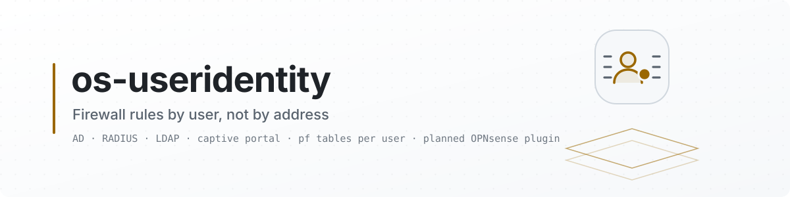

<picture>
  <source media="(prefers-color-scheme: dark)" srcset="docs/images/readme/banner-dark.svg">
  <source media="(prefers-color-scheme: light)" srcset="docs/images/readme/banner-light.svg">
  
</picture>

<p align="center">
  
  <a href="https://github.com/AbdelmonemAwad/os-useridentity/actions/workflows/checks.yml"></a>
  <a href="LICENSE"></a>
  <a href="#what-is-tested"></a>
  <a href="https://github.com/AbdelmonemAwad/opnsense-arabic"></a>
  <a href="https://github.com/AbdelmonemAwad/os-xgs-npu"></a>
</p>

# User Identity for OPNsense

Who is behind an address: logons read from the Active Directory domain controllers - RADIUS accounting and the captive portal are the next part - with the directory asked for each user's groups, kept as pf tables per group and per user, for rules, traffic priority and web policies.

> ~~**Planned - nothing here runs yet.** This repository was opened on 2026-11-16 to hold
> User Identity as a plugin of its own. No code has been written or moved into it, and there is no
> release.~~
>
> **Written, not released (2026-11-18).** The first part is here: the engine and the Active Directory
> source - each address mapped to its user from the domain controllers' logon events, the user's groups
> asked of the directory, a table for each group chosen and each user named. Off by default. It has
> not run on an appliance yet: what was run is under [What is tested](#what-is-tested).

<p align="center"><b>Contents:</b> <a href="#what-it-does">What it does</a> &middot; <a href="#how-a-logon-becomes-a-table">How a logon becomes a table</a> &middot; <a href="#not-yet-and-why">Not yet, and why</a> &middot; <a href="#what-is-tested">What is tested</a> &middot; <a href="#installation">Installation</a> &middot; <a href="#updates">Updates</a> &middot; <a href="#where-it-fits">Where it fits</a> &middot; <a href="#licence">Licence</a></p>

## What it does

**Firewall: User Identity** (XGS: User Identity, order 60, when os-xgs-npu is installed), one page, off
by default:

- **the map** - each address on the network with the user its domain controller last saw logging on from
  it, from two events of the Windows Security log: 4768, a ticket-granting ticket issued, and 4624, a
  logon to the domain controller with the client's address. NXLog Community Edition on each domain
  controller sends them as JSON over TCP; the page shows its configuration to copy - each event's time in
  UTC with its zone (`DateFormat`), and the event's long text left out (`delete($Message)`), which
  nothing here reads;
- **the groups** - the directory chosen in System: Access: Servers is asked which of the chosen groups
  each user is in: directly, or, with Nested groups on, through a group inside it, by Active
  Directory's in-chain rule;
- **the tables** - for each group row, the addresses of its users; for each user named, that user's
  addresses. Each is an alias of type External in Firewall: Aliases, `uid_` and a name the row gives -
  proposed from the group's or the user's name, 31 characters at most - so a rule's source or
  destination can name it. A table is made from the map each time, never edited by an event alone;
- **the cut** - where os-xgs-npu is installed, XGS: Settings' "Cut open connections when listed" holds
  these tables, beside the owner's own entries: an address that joins one has the connections it
  already had cut within a minute, in hardware first. Leaving a table cuts nothing. Without os-xgs-npu
  nothing is cut, and the page says so;
- **the cards and tabs** - users present, groups and the directory's state, domain controllers heard,
  the last event; then Users (the live map, an address shared marked, Forget every mapping, and the
  user rows), Groups (the group rows, the addresses each table holds, and a Test that asks the
  directory about one user), Sources (each domain controller's last line and last event, how late it
  came, what was taken, renewed, stale and refused and why, and NXLog's configuration) and Settings;
- **alerts** - a domain controller silent for the minutes Settings gives, the directory failing, an
  address newly shared: one file each in os-xgs-npu's form under `/var/db/os-useridentity/alerts`, for
  os-netreport to send.

Only the live map is kept. The system log says how many addresses were mapped, changed user or left;
it names them only with Log user names on. A history of the mappings is kept only for the days Settings
gives, none by default.

## How a logon becomes a table

The design is phase 0's, settled on 2026-11-17 by the plan, the new-plugin standard and a lab with a
Windows Server 2025 domain controller, a Windows 11 client and NXLog CE on the second XGS 3300 -
NXLog's and the domain controller's behaviour, not this plugin's:

- **received by OPNsense's own syslog-ng** - a source of the plugin's on 127.0.0.1, TCP, port 5141, in
  `/usr/local/etc/syslog-ng.conf.d/useridentity.conf`, and a pf redirect, on the chosen interfaces, from
  each domain controller named in Settings and no other address, of the port the domain controllers
  send to (514 by default) to that source - os-xgs-npu's way for the coprocessor's log. The redirect is
  the gate: phase 0's lab saw a line from a machine that is no domain controller arrive as easily, so
  the plugin reads only what the named addresses send, and syslog-ng's source is reached by nothing
  else from the network. syslog-ng cannot listen on an interface's address, and one source that cannot
  bind stops it whole, with every log of OPNsense's: so the source is written only on a port no other
  program holds, and only when syslog-ng takes its whole configuration with it; else the page says why,
  and no redirect is registered. The lines go to no log file: syslog-ng hands each to the plugin's
  collector, over a socket, with the address it came from;
- **what maps** - a ticket issued (4768, Status 0x0), its address written `::ffff:a.b.c.d` for IPv4,
  comes 1.5 to 2.4 seconds after a logon, and again at an unlock; network logons to the domain
  controller (4624) renew an idle session - in the lab's idle hour, 37 lines about the user in six
  bursts, the longest gap 22 minutes. Every other event is counted and set aside;
- **what never maps** - a computer account (every logon through a task or runas gives one first), an
  account that is no domain user (SYSTEM, ANONYMOUS LOGON, the virtual accounts), an event older than
  Stale after when it arrives - NXLog CE sends again, when it starts, what it held while stopped, ten
  minutes old in the lab - the firewall's own addresses (OPNsense's own LDAP connector binds as a user
  from one of them), a domain controller's, loopback, link-local, multicast and broadcast addresses,
  Never map's addresses and Ignore users' users. An event's time with a zone - the page's NXLog
  configuration sends one - is read as it says; one with none, NXLog CE's default, in the firewall's own
  time zone;
- **the latest wins** - an address another user logs on from takes that user, and is marked shared
  while the one before is still within the lifetime: in the lab a runas on a client moved its address
  to the runas user while another sat at its screen. Never map is for terminal servers and NAT inside
  the network;
- **nothing says a user left** - a lock and a logoff send nothing that does, and a logoff event carries
  no address. A mapping ends at the end of its lifetime - 480 minutes with no event about it, until the
  lab's four-hour measurement says otherwise - when the address's MAC in the firewall's ARP or neighbour
  table changes, checked every minute (behind a router the firewall sees no MAC), or when forgotten on
  the page;
- **the groups** - asked when a user is first seen and again after 15 minutes, in a thread of their
  own, so a directory slow to answer never holds the events back; the user's addresses join its own
  table at once and its groups' when the directory answers. Windows Server 2025 refuses a simple bind
  in the clear: the entry of System: Access: Servers must use StartTLS or SSL, with the domain's
  certificate authority in System: Trust and the domain controller named as its certificate names it -
  the plugin checks the certificate and the name as OPNsense's own connector does, with its own CA file.
  OPNsense's connector reads memberOf alone; the lab found a user in a group only through a group
  inside it by the in-chain rule;
- **every minute** - from cron, whether the collector runs or not: the lifetimes ended, the MAC check,
  every table made again from the map, so one emptied by hand or written while the collector was down is
  right within a minute.

## Not yet, and why

- **on an appliance, and the page in a browser** - nothing of this plugin has run on an XGS or a plain
  OPNsense yet; the lab must run phase 0's transport, latency and cut steps again with it (A2, A4, A7),
  and the page has not been opened in a browser, in either theme or language.
- **the lifetime** - 480 minutes is the settled starting point; the lab's four-hour measurement of how
  often an idle and an active session renew (A5) is still owed, and the default follows it.
- **RADIUS accounting and the captive portal** - the plan's phase 2: os-freeradius's accounting files
  (phase 0's lab read them) and the portal's sessions as sources beside Active Directory.
- **TLS from the domain controllers** - phase 2. Today the redirect from the named addresses is the
  gate; a machine on a domain controller's own segment that spoofs its address could still send a line.
- **a rule's gateway by user** - phase 3, with os-xgs-npu's hardware side (its pull request for
  route-to in the coprocessor).
- **several domains** - users are known by their logon name: two domains of one forest with a user of
  the same name are one user here, and a forest needs a global catalog.
- **a domain controller sending over IPv6** - the redirect and syslog-ng's source are IPv4; a client's
  IPv6 address maps as any other.
- **a cut when an address leaves a table** - only joining cuts, through XGS: Settings; a connection open
  before its address left a table keeps going until it ends.

## What is tested

On 2026-11-18, from this branch, away from an appliance - the checks, run under Python 3.14 and PHP 8.5:

- **the domain controllers' lines** - `tools/test-events.py`, 89 checks: the 25 lines of phase 0's lab
  (A2, A6, A4) in `tools/fixtures/lab-events.txt`, every address made a documentation one, every name an
  example, each read as the lab saw it - tickets and network logons map, computer accounts, SYSTEM and
  the virtual accounts, a logon with no address, a logoff and a service ticket do not - and lines made
  from them: a refused ticket, loopback, link-local, multicast, broadcast and unspecified addresses,
  IPv6, a name written `user@REALM` or `DOMAIN\name`, a syslog header before the JSON, EventTime in two
  time zones and in ISO form, the stale window's edges, the firewall's and a domain controller's
  addresses, Never map, Ignore users;
- **the map and its tables** - `tools/test-engine.py`, 70 checks: join, renew, latest wins and the shared
  mark, an older event noted, the lifetime's end, the MAC check, the flush, the lab's A6 - three logons
  on one client in a row - played through, the tables of groups and of users, pf through a stand-in
  (64 addresses a call, a failure said, the tables of aliases gone killed), the log's counts without
  names, the history and its pruning, the map's file and lock, FreeBSD's `ifconfig -a`, `arp -an` and
  `ndp -an` output, and the settings read from a `config.xml` fixture;
- **the directory** - `tools/test-ldap.py`, 38 checks against a stand-in of ldap3: the filter's escaping
  of a name or a DN, the filters from the entry of System: Access: Servers, TLS for StartTLS, SSL and
  Standard with OPNsense's CA file, direct and nested membership, a group not there, a server refusing
  the in-chain rule asked it no more, Nested groups off, the Test's answer, a refused bind with the
  password taken out. Its last part runs ldap3 2.9.1's own constructors and filter code, where ldap3 is
  installed - in CI; it was not installed here, so that part has not run yet;
- **the service** - `tools/test-service.py`, 64 checks in a temporary directory: syslog-ng's source
  written, kept, refused for a port in use, a port it may not take, sockstat unreadable and syslog-ng's
  check refusing it, taken away when off; the collector reading the lab's lines through a real datagram
  socket, its counts by reason, a machine that is no domain controller refused, the directory's answer
  filling a group's table, latest wins emptying a user's, no directory asked when none is chosen, its
  answers forgotten once their users leave the map; the minute's run, Forget all, the plugin off and a
  switched-off alias's table kept empty; the alerts; what `status.py` gives the page;
- **the firewall hook** - `tools/test-firewall-hook.py`, 24 checks, os-xgs-npu's harness: the redirects
  through each OPNsense's own method name (26.7, 26.7.3 to 26.7.8, 27.1), a bad domain controller entry
  left out, a refusing object not stopping the reload, nothing while off or with the source not there;
- **the aliases** - `tools/test-aliases.php`, 34 checks, with stand-ins for OPNsense's Alias model whose
  validation is OPNsense 26.7's own for the fields written, pf's reserved words included: the names
  proposed - Latin, spaced, in another script, too long, taken - each taken by that validation; aliases
  made, switched off where a rule names them; XGS: Settings' cut list keeping the owner's entries; and
  `aliases.php` run as configd runs it;
- **the page's API** - `tools/test-mvc.php`, 34 checks: the status, the grids, Apply's order on and off,
  syslog-ng restarted only when its source changed, Forget all, the Test's names quoted or refused, the
  alias names proposed;
- **the installation** - `tools/test-install.py`, 33 checks, the installer, the removal, the package's
  scripts, `place-menu.sh` and the rc script in a temporary root: every file laid down with its mode and
  taken away, the menu at XGS 60 or under Firewall, nothing copied with a syntax error, syslog-ng's
  source taken away by every removal, nothing done by the old package in an upgrade;
- **the self-update** - `tools/test-self-update.py`, 45 checks, as os-blocklists has it;
- **the strings** - `tools/check-strings.py`: each of the 147 strings the GUI shows is in `source.json`;
  35 have their Arabic in opnsense-arabic already, the other 112 wait for it there;
- **the rest** - every installed file removed by the uninstaller (`tools/check-uninstall.sh`), `php -l`,
  `py_compile` and pyflakes, `sh -n`, XML and JSON, nothing private, no Arabic in the code, the copyright
  line; and, by hand, the page kit (kit) and the page's script run under node with a stand-in jQuery -
  a status, an error, no answer, the plugin off, the source not written, and each grid's formatters.

Not tested: anything on an appliance or a plain OPNsense (above).

## Installation

It is not in the OPNsense plugin repository, so there is no `pkg install os-useridentity`, and there is
no release yet.

**From a checkout** of this repository, on the firewall, as root:

```sh
sh install/install.sh
```

It checks the PHP with `php -l` and the Python with `py_compile` before anything is copied, copies
`src/` onto `/usr/local`, puts the page in the menu (`place-menu.sh`: XGS with os-xgs-npu, Firewall
without), and does what the page's Apply does. Nothing is mapped until it is on, with domain
controllers named in Settings, a directory chosen and group or user rows given. Safe to run again: the
settings in config.xml are kept. No package is needed beside it: py-ldap3 is part of OPNsense's core.

Then, on each domain controller: NXLog Community Edition, with the configuration Sources shows.

`sh install/uninstall.sh` stops the collector, forgets the map, takes the plugin's aliases out of
Firewall: Aliases and XGS: Settings' cut list (switched off instead where a rule or a setting still
names one), takes syslog-ng's source away, removes its files and its state, and takes the tables of the
aliases gone out of pf. The settings stay in config.xml.

**From a package**, once there is a release: `tools/make-package.sh` builds it on a firewall, and
`release.yml` in a FreeBSD virtual machine for each release, as os-blocklists does.

## Updates

As os-blocklists: taken by hand, to this repository's **releases** - from **XGS: Updates**, its
*Plugins* tab, where an os-xgs-npu that lists this plugin is installed, or by running
`/usr/local/opnsense/scripts/useridentity/self-update.py` (`check` to ask). A release is installed only
as its owner signed it (`release.json` and its Ed25519 signature, the public key in `release-keys/`),
only forward, by the `install/install.sh` it carries. No cron entry runs it.

## Where it fits

It is one part of the [os-xgs-npu](https://github.com/AbdelmonemAwad/os-xgs-npu) project, which puts OPNsense on Sophos XGS hardware, and works the way its other plugins do: changes by pull request, a release installed from **XGS: Updates**, its Arabic in [opnsense-arabic](https://github.com/AbdelmonemAwad/opnsense-arabic)'s catalogue. It installs the same on a plain OPNsense, where pf alone holds the tables and the page says that no open connection is cut.

## Licence

BSD 2-Clause - see [LICENSE](LICENSE).
